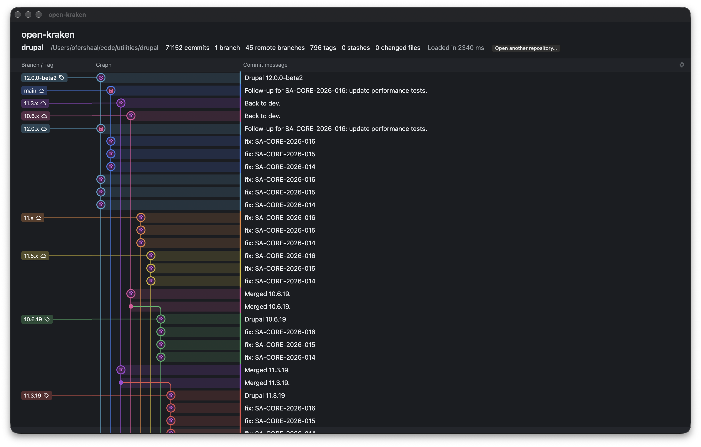

# open-kraken

Desktop git client with an interactive commit graph. Built with Tauri 2, React and TypeScript; git access goes through the `git` command-line tool.

What you see: the [Drupal core](https://git.drupalcode.org/project/drupal) repository, 71 152 commits, read and laid out in 2.3 seconds (debug build). Each colored lane is one line of development. Here the release branches (`main`, `12.0.x`, `11.3.x`, `11.x`, `11.5.x`, `10.6.x`) get the same security fixes side by side. A small solid dot is a merge commit, for example `Merged 10.6.19.`, where the 10.6.19 release joins its branch again. The left column labels branch tips and tags in the color of their lane: a cloud for a remote branch, a tag icon for a tag. Only the rows on the screen are drawn, so a history this long still scrolls smoothly.

Status: early development. The app opens a repository and draws its commit graph: lanes, merges, branch and tag labels, and rows for uncommitted changes and stashes. Selection, the details panel and git actions come next. The plan is in [ROADMAP.md](ROADMAP.md); the target behavior is in [docs/graph-behavior-spec.md](docs/graph-behavior-spec.md).

## Prerequisites

- Node.js 22 or newer, and pnpm 10 (`corepack enable` picks the version from `package.json`).
- Rust stable, 1.90 or newer (`rust-version` in `Cargo.toml`).
- git 2.32 or newer.
- The Tauri system packages for your platform: <https://tauri.app/start/prerequisites/> (on macOS: the Xcode Command Line Tools).

## Commands

| Command | What it does |
|---|---|
| `pnpm install` | Install the JavaScript dependencies. |
| `pnpm tauri dev` | Run the desktop app with hot reload. `pnpm tauri dev -- -- /absolute/path/to/repo` opens a repository at start. |
| `pnpm dev` | Run only the web frontend in a browser (port 1420), on the demo repo fixture (`?fixture=edge`: the edge-case fixture; `?synthetic=50000`: a generated history). |
| `pnpm tauri build` | Build the release app and installers. |
| `pnpm test` | Run the frontend tests (Vitest). |
| `pnpm typecheck` | Type-check the frontend (TypeScript, strict). |
| `pnpm lint` | Lint (ESLint) and check formatting (Prettier). `pnpm format` fixes formatting. |
| `cargo test -p git-data` | Run the git-data crate tests (no Tauri or webkit needed). |
| `cargo fmt --all --check` | Check Rust formatting. |
| `cargo clippy --workspace --all-targets -- -D warnings` | Lint the Rust code. |
| `docs/fixtures/verify-demo-repo.sh` | Check the demo repo fixture builds the same SHAs everywhere. |
| `scripts/update-fixture.sh` | Regenerate the browser fixtures: `fixtures/demo-repo.json` from the demo repo, and `fixtures/edge-repo.json` from the demo repo plus edge cases. |

CI (`.github/workflows/ci.yml`) runs the frontend checks, the git-data checks (also on Rust 1.90), the fixture check and actionlint on every pull request and on `main`.

## Layout

- `src/`: React frontend.
- `src-tauri/`: Tauri app crate.
- `crates/git-data/`: git access through the `git` CLI. No Tauri dependency, so it builds and tests anywhere. Its tests also write the TypeScript types to `src/git/bindings/` (generated; do not edit).
- `src/git/`: the adapter the UI reads data through: Tauri commands in the app, the `fixtures/` JSON in a browser or test.
- `fixtures/`: generated data for the browser and tests.
- `docs/`: the behavior spec, the demo repo fixture (`docs/fixtures/make-demo-repo.sh`) and the README screenshot (`docs/images/`).

## Clean room

open-kraken models GitKraken Desktop's behavior from public documentation and normal use of the app only. No GitKraken code is read or copied. See [CLAUDE.md](CLAUDE.md) for the rules.

## License

[MIT](LICENSE)
